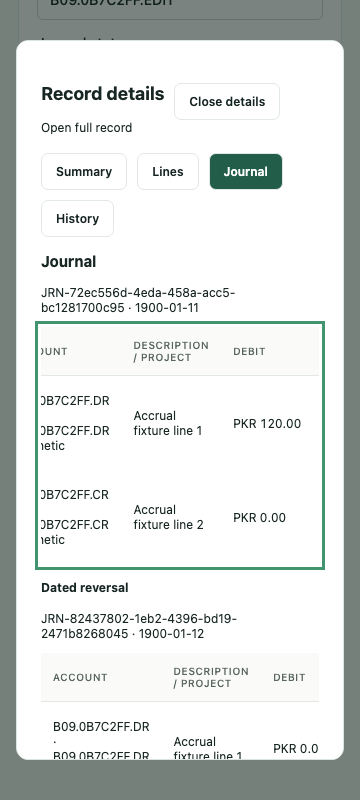
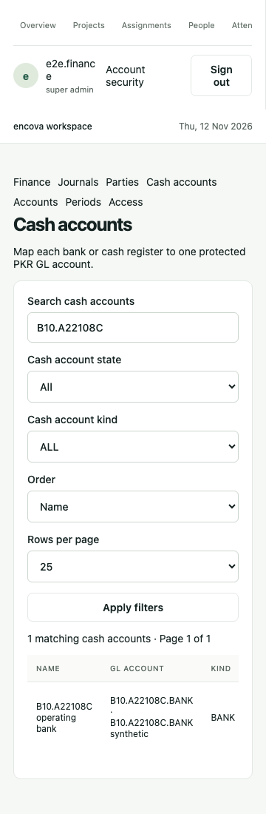

# Encova Finance — F06–F10 delivery report

Date: 12 November 2026 (Asia/Karachi). Requested by Talha: complete through F10, test/reverify, commit/push and provide a report.

**Delivered through F10: 10/48 finance milestones complete; 38 remain.** 488 distinct local tests: 185 unit, 275 real PostgreSQL integration and 28 Chromium browser. Strict typing/lint and both local/Supabase-mode production builds passed. Publication and exact-source clean-runner CI are pending; local evidence below is complete.

| Milestone | Delivered behavior | Verification |
| --- | --- | --- |
| F06 | Exact PKR draft/line tables and shared manual journal engine; deferred PostgreSQL balancing/source checks; immutable postings and atomic usage locks | Raw SQL imbalance/tampering, controls/period/date/current access and rollback tests |
| F07 | Permanent canonical receipts, source identities, versions, dated opposite reversals, atomic batch void and restricted revision snapshots | Concurrent same/different-key posts, stale edits, exact reversal history, identified batch conflicts and retry-after-commit browser case |
| F08 | Core prepayment/accrual/recognition/reversal subset; lock/design review and estimate revision | Exact dated cutoff and 140,000 debit/credit proof; full commercial fixture remains later |
| F09 | Shared registers with search/date/state/order/page controls, full-filter original totals, inline draft drawer, loading/error/retry, keyboard/mobile support | Actual journal UI journey, 360px WCAG scan, horizontal keyboard scroll, Escape/focus, current revocation and no-JavaScript detail |
| F10 | Parties, optional person/contact source, unique protected cash-GL mapping with last four digits, owner lifecycle controls; shared chart UI and paginated eligible search | Master schema/permission/version/usage/retention/RLS tests and actual party/cash UI journey |

## Activity record

| Work-log step | Action and progress |
| --- | --- |
| 252 | Read actual code/specification and began the explicitly authorized five-milestone scope |
| 253 | Added/verified core ledger, lifecycle, revision history, concurrency and dated accounting subset |
| 254 | Built shared register/drawer and verified the first real journal browser journey; corrected date/label/cleanup issues |
| 255 | Added party/cash owner setup, protected mappings, searchable chart choices and complete backend regression |
| 256 | Closed exact snapshot/batch/retry boundaries; full local 488-test regression and both builds passed; reports prepared |
| Publication | Exact source, clean-runner CI and final report commit are recorded below when complete |

The [complete work log](../work-log.md) and [focused verification](testing/F06-F10-results.md) retain commands, failures/corrections and results. The full [Word progress tracker](../Encova_Progress_Report.docx) includes prior ERP and finance history. A focused Encova_F06-F10_Report.docx is exported alongside this file.

## Boundaries and next work

All new migrations/configuration are local/test-only. Hosted ERP stays on 17 migrations with finance disabled; no real owner/grant, company chart/fiscal period/opening balance, live deployment, credential change or merge occurred. Manual journals reject protected cash/AR/AP/advance/asset/investment/loan controls. Cash-account setup stores no balance or full bank number and does not execute transfers. No financial statements or company/accountant approval are implied by a balanced engine subset.

Next F11: typed earned/deferred invoices and posting services. Remaining work includes receipts/settlements, payables, assets/investments/funding, reconciliation, statements/exports/closing/opening books, restore and accountant acceptance. At F08 the remaining planning range was revised to 260–360 focused engineering hours; after F10 the working range is 240–340, excluding human/provider waiting. No actual hours or delivery date are invented. Original 60-day learning progress is preserved.

## Synthetic mobile evidence

Final report validation: full and focused Word ZIP/XML/image relationships passed; macOS extracted the focused document successfully. Configured private-value scan passed across all99 milestone files. Exact-source publication and CI are being recorded.
