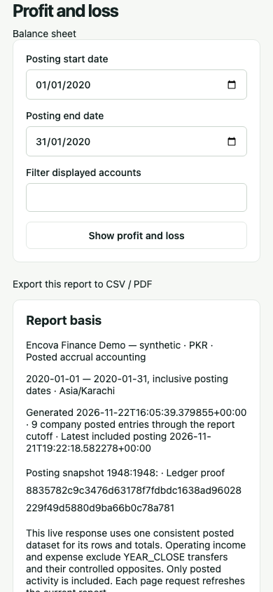

# Encova isolated finance demo

Delivered 22 November 2026, Asia/Karachi. Talha chose the isolated synthetic demo and then explicitly chose to keep it local after hosted capacity was unavailable. This is a separate review environment; the existing Vercel ERP and intended real Finance Owner are unchanged.

## Open and sign in

Open http://localhost:49278/login on this Mac. Use finance.owner@example.test for the Finance Owner. Initial passwords for all six accounts are in the private local file `.local/finance-demo/logins.json`; they are excluded from Git and this report. Do not use the live ERP credentials here.

| Synthetic account | Role and expected finance access |
| --- | --- |
| finance.owner@example.test | Super Admin / Finance Owner; authorized finance commands |
| finance.selected@example.test | Selected Super Admin; private financial statements |
| finance.unselected@example.test | Unselected Super Admin; finance denied |
| finance.hr@example.test | HR Admin; finance denied |
| finance.lead@example.test | Team Lead; finance denied |
| finance.member@example.test | Member; finance denied |

The amber demo notice identifies synthetic January 2020 books. Authorized finance navigation includes shortcuts for January 2020 trial balance, profit and loss, and balance sheet. Current-date reports may show no movements because the example transactions are dated January 2020. Report exports are REVIEW copies; incomplete company readiness correctly blocks FINAL issuance.

## Start, verify and stop

From this repository with Node 24, pnpm 12.18.0 and installed dependencies:

```
pnpm finance:demo
pnpm finance:demo:verify
pnpm finance:demo:stop
```

Start runs in the foreground and can also be stopped with Ctrl+C. First initialization applies all 84 migrations to its own PostgreSQL cluster, creates six synthetic identities and nine normally posted sources, then builds a separate application copy. Restart rebuilds that copy and retains accounts, password changes, books and audit history. A duplicate start detects the owned running process and returns its URL. The generated manifest chooses ports on first use; use the URL printed by the command on another checkout rather than assuming this Mac's port. The private logins file records initial credentials only; it cannot recover a password you later change.

The verifier signs in as all six accounts, creates and voids one unposted synthetic draft, and creates a private review export. These retained audit records are intentional. It does not reset the books or add a posted journal. If you edit/post sample books yourself, the exact baseline assertions can fail; stop and inspect your changes rather than deleting financial history to pass verification. Private logs, data, source copy and screenshots remain under `.local/finance-demo/`.

## Expected sample statements

| January 2020 measure | Exact PKR value |
| --- | --- |
| Posted sources | 9 |
| Debit turnover / credit turnover | 1,445,000.00 each |
| Bank | 575,000.00 |
| Earned profit | 180,000.00 |
| Assets | 785,000.00 |
| Liabilities | 105,000.00 |
| Equity | 680,000.00 |
| Assets minus liabilities and equity | 0.00 |
| Project contribution / recorded project cash | 180,000.00 / 110,000.00 |

The checked representative fixture supplies these values through existing posting services, not direct raw financial inserts. See [the complete statement explanation](acceptance-fixture.md).

## Isolation and limits

The application and PostgreSQL listen on loopback and use their own persistent directory and ports. The demo does not inherit database, cloud or email credentials from the shell or project. Its source copy excludes private environment files, deployment configuration and `.local/`; its `.next` build is separate. The runtime connects as restricted encova_app. Local-only legacy auth grants permit sign-in, while raw financial writes/core execution and browser-role reads remain denied. Demo sessions use their own cookie namespace and preserve another localhost workspace's cookie.

Email and external Storage/scanner providers are not connected. Upload scanning, inbox delivery, hosted Supabase Auth/MFA, managed backups and remote availability are not established by this local demo. Use synthetic records only. The notice flag does not grant finance access or enable finance by itself; the isolated launcher explicitly configures the demo. Hosted security rules and setup.sql were not weakened.

A separate free Encova Finance Demo organization was created, but Supabase rejected a project because this account had reached its two-active-Free-project limit. The new organization has zero projects. Talha chose local-only continuation; no existing project was paused/deleted, billing upgraded, Vercel project deployed or production environment changed. Hosted provisioning is stopped.

## Completed checks and corrected attempts

- All 358 unit tests passed (6.00 seconds), including five demo configuration/process checks.
- Four new real PostgreSQL integration cases passed (14.37 seconds): fresh initialization through real reauthentication/posting services, retained-history reseed refusal, restricted runtime privileges, and data-directory ownership rejection before setup grants.
- Six affected Chromium regressions passed (15.8 seconds): ordinary authentication/accessibility, finance access, receipts and supplier payments. Normal mode still uses its original authentication configuration.
- Seven actual running-demo browser/security scenarios passed, covering six real sign-ins, isolated session cookies, exact profit/balance sheet/bank/trial balance, owner draft/void, export CSV/PDF hashes and private headers, role/page/artifact denial, mobile/WCAG/keyboard access and unchanged nine posted sources. [Safe evidence](evidence/isolated-demo-verification.json) records this run.
- Normal production, Supabase-shaped production and the separate local webpack production builds passed. Strict TypeScript and ESLint passed. Stop/restart retained the books, duplicate start preserved the running demo and all 84 migrations were applied to fresh owned initialization databases.

Corrected and reran actual failures: required NODE_ENV typing; an already-seeded CompanySettings singleton (changed to upsert before financial seeding); six invalid Next page re-exports with an extra resource prop (proper page wrappers now pass the resource); and local legacy auth permissions scoped to the verified owned database. A verifier was initially run before readiness. A later export verifier incorrectly assumed HTTP 201; the existing contract is HTTP 202 Accepted. It now asserts that contract and verifies the real resulting ready page and file bytes. No product financial assertion, migration checksum, hosted permission or final-export readiness control was bypassed.

These are observed targeted results, not a claim that the entire previous 1,218-test suite was rerun for this change. Fresh branch CI is tracked separately after publication. F47 actual company review and F48 live setup remain pending; this demo does not create company policy acceptance.

## Mobile review evidence


