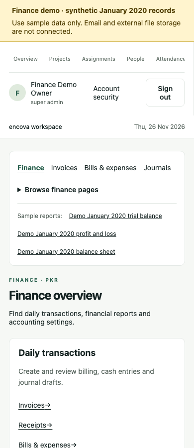
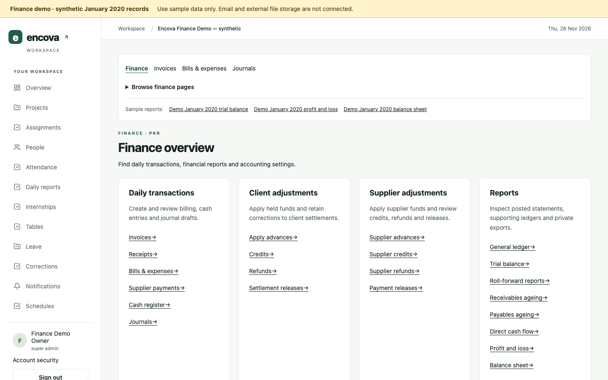
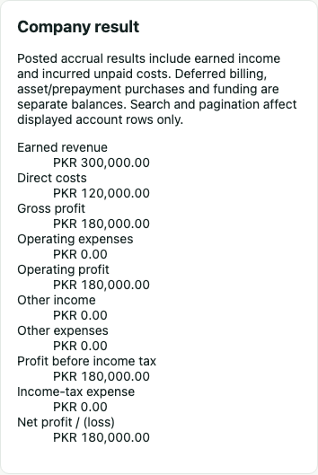

# Finance usability review — updated 27 November 2026

Talha selected a review of the local finance screens and fixes for observed usability issues. Hosting stays local. The review covers the finance landing page, profit and loss, invoices/register, new invoice, new bill, new journal and report export form on desktop and mobile.

## Observed issues and changes

| Issue | Result |
| --- | --- |
| Flat finance navigation occupied 503px on a 390px-wide invoice/form screen | A compact navigation panel keeps daily shortcuts visible and puts the full directory in a native disclosure, with search, eight named groups and an active-page indicator |
| Landing page exposed only a small subset of modules under Finance setup | Finance overview now provides grouped links and explanations for every existing module |
| Switching from historical profit and loss to balance sheet reset to today's cutoff | Balance sheet at period end preserves the chosen end date; the explicitly named return link opens profit and loss for that cutoff's month |

All 50 original navigation destinations are retained, along with the three January 2020 demo report shortcuts. The directory and navigation share one list. Links avoid automatic prefetching of the entire private finance directory. The native disclosure works with keyboard controls and still exposes its links before client JavaScript; search and active-page marking are client enhancements. A no-results message helps recover from an unmatched search. The directory does not grant permission: existing server-side finance selection and role boundaries remain in force.

## How to use it

Open http://localhost:49278/login and use a synthetic account from the private `.local/finance-demo/logins.json`. Choose Finance, then a grouped link or Browse finance pages. Search by page or group name, such as loans, reports or supplier. Daily invoice/bill/journal shortcuts remain visible while the full menu is closed. On a report, use Balance sheet at period end to keep the selected cutoff; the return link explicitly opens that month rather than claiming to reconstruct an arbitrary earlier date range.

These changes do not alter report calculations, posting services, money precision, database schema, permissions or company policy. Lower roles and unselected administrators remain denied finance access. Email, external Storage/scanner and hosted finance setup remain unconnected/deferred for this local demo.

## Verification

- All 358 unit tests passed in 6.99 seconds. Strict TypeScript and clean ESLint passed.
- Eight focused Chromium tests passed in 23.8 seconds: two new usability journeys, finance selection/revocation and anonymous/lower-role denial, existing statement/ledger money checks and core accessibility. Keyboard opening/search, empty search recovery, active-page indication, menu reset after navigation, 360px layout/WCAG and report cutoff/export-filter preservation are covered.
- Seven actual retained-demo browser/security scenarios passed again: six real role sign-ins, isolated cookies, exact bank/profit/assets/trial totals, normal draft/void, private CSV/PDF hashes, denial boundaries, mobile/WCAG/keyboard and unchanged nine posted sources. [Financial evidence](evidence/usability-financial-verification.json) records this separate local run.
- All 49 existing module-directory pages were also opened at both desktop and mobile widths: 98 read-only page checks returned HTTP 200 with no page-level horizontal overflow. The separate overview route is covered in the representative screen run. [Directory evidence](evidence/usability-directory.json) records every route.
- All 14 actual screen layouts (seven routes at 1440px and 390px) returned HTTP 200 with no page-level horizontal overflow. The collapsed mobile menu measured 231px compared with 503px before; the invoice heading moved from 831px to 556px from the viewport top. [Screen results](evidence/usability-screens.json) and [comparison](evidence/usability-comparison.json) preserve the measurements. Four representative desktop/mobile overview and profit-report accessibility scans passed. Visual screenshots were inspected directly.
- Normal production, Supabase-shaped production and separate demo webpack builds passed. The demo was stopped through its ownership-checked command and restarted with retained identities/books; no reseeding occurred. The local app remains running at the same URL.
- All 250 API/documentation contracts, local documentation links, Word package/XML/relationships, configured private-value checks and git whitespace checks accompany publication. No migrations or accounting services changed, so additional full local PostgreSQL regression was not required for this UI pass; fresh PR CI independently runs the complete suite.

One setup attempt correctly refused fixture preparation because the shell's default database was not encova_test. The target guard stayed intact; preparation and the final eight-browser run were repeated with the explicit dedicated loopback test URL. An unused import produced a lint warning and was removed; final lint is clean. The earlier eight-browser pass (22.1 seconds) is retained separately and not added to the distinct eight-test count.

[Fresh PR CI45700584090](https://github.com/TalhanAhmad/ERP-SYSTEM/actions/runs/45700584090) passed on source aca83b2f8ce58f9a865a9c9a330f3731392237d5: 358 unit, 806 PostgreSQL integration and 65 Chromium tests (1,229 total), 84 migrations, both production builds, types/lint and 250 API/documentation contracts. Source is published in [PR #10](https://github.com/TalhanAhmad/ERP-SYSTEM/pull/10); merge remains pending. No real company policy acceptance, hosted finance setup, production deployment or paid upgrade occurred.

## Current-page menu selection — 27 November 2026

A final real-browser interaction check reproduced one remaining issue: on Loans, opening Browse finance pages, searching loans and selecting the current Loans page left the menu open and retained the search. The pathname had not changed, so the existing route-change reset did not run.

Finance links now dismiss the menu and clear its search on client-side navigation, including current-page and query-only transitions. When the disclosure closes, keyboard focus returns to Browse finance pages rather than staying on a hidden link. The extended keyboard/browser journey verifies clicking the active page closes the menu, restores focus and allows Enter to reopen with an empty search. Next's navigation event preserves the original menu state when a modifier opens a separate window/tab. No accounting or authorization behavior changes.

The prior full CI above verifies aca83b2 only; the small follow-up has its own focused checks and fresh CI after publication. The follow-up passed all 358 units (7.14 seconds), eight focused Chromium tests (22.0 seconds), strict TypeScript/clean lint, normal and Supabase-shaped production builds and the separate retained-demo webpack build. The real local demo also passed current-page/query-only navigation, cleared search/restored focus, and Shift-click new-window preservation; [interaction evidence](evidence/usability-current-page-verification.json) records the observed before/after state. The first diagnostic waited for a page-level popup event and timed out; the successful check used the browser-context page event and Shift-click. No product assertion or permission was removed to obtain that result.

All seven retained-demo financial/security scenarios passed again, with nine posted sources and exact statement totals unchanged; [financial evidence](evidence/usability-menu-financial-verification.json) records this run. The demo was stopped/restarted through the owned process controls with retained accounts/books. The earlier 98 directory layouts and 14 representative screen layouts remain the 26 November evidence; they were not rerun for this event-handler-only follow-up.

The updated source is committed/pushed to the existing PR #10, with fresh CI tracked separately from the completed aca83b2 run. Merge, actual company review and any future hosted finance setup remain pending. Local-only scope is unchanged.

## Visual review

Mobile finance overview:

Desktop finance overview:

Retained sample profit:

